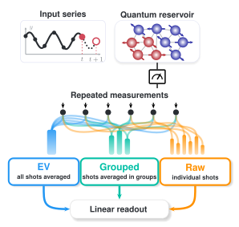

# From Quantum Shots to Training Data: Reorganizing Measurement Records in Quantum Machine Learning

[](https://github.com/eybmits/adaptive-shot-aggregation/actions/workflows/verify.yml)
[](https://www.python.org/)
[](LICENSE)

Reproducibility package for **From Quantum Shots to Training Data:
Reorganizing Measurement Records in Quantum Machine Learning**.

Quantum experiments produce repeated measurement outcomes. A learning pipeline
must decide how those outcomes become training examples. This repository studies
that decision under a fixed execution budget. It compares three representations
of the same shot record:

| Representation | Shots per training view | Views per time step |
|---|---:|---:|
| Raw | `k = 1` | `N` |
| Grouped | `1 < k < N` | `N / k` |
| Expectation value (EV) | `k = N` | `1` |

Grouped training averages disjoint sets of shots. The group size `k` and ridge
strength are chosen on chronological validation blocks. The circuit, targets,
raw measurements, and test procedure remain fixed across methods.

<p align="center">
  <a href="paper/gfx/fig1_shot_organization.pdf">
    
  </a>
</p>

<p align="center">
  <a href="paper/gfx/fig1_shot_organization.pdf">Open Figure 1 as a publication-quality vector PDF</a>
</p>

## Main result

At the balanced budget of 500 time steps and 20 shots per step, Grouped lowers
mean test NRMSE on all four tasks. Relative reductions are computed as
`(EV - Grouped) / EV`.

| Task | EV | Grouped | Relative error reduction | 95% interval for EV minus Grouped |
|---|---:|---:|---:|---:|
| Mackey-Glass | 0.4838 | 0.4392 | **9.21%** | **[0.0372, 0.0519]** |
| Santa Fe laser | 0.7644 | 0.6797 | **11.09%** | **[0.0174, 0.1522]** |
| Rossler | 0.4137 | 0.3788 | **8.44%** | **[0.0139, 0.0559]** |
| Sunspots | 0.5531 | 0.5171 | **6.50%** | **[0.0103, 0.0616]** |

The mean NRMSE across the four tasks falls from 0.5537 to 0.5037, a 9.04%
reduction at unchanged quantum execution cost. All four paired intervals remain
above zero.

The covariance-regularized EV control closely matches Grouped. This agrees with
the exact squared-loss identity in the paper: grouped views add a covariance
penalty estimated from the record's own shot fluctuations. The result concerns
finite-shot data organization. It is not a claim of quantum advantage or a
universal group size.

## Repository structure

```text
configs/       Frozen simulation protocols and the full rerun configuration
data/          Pinned Santa Fe laser and sunspot source series
docs/          Reproducibility, hardware, data, and result documentation
output/pdf/    Named and anonymous papers, supplements, and checksums
paper/         LaTeX sources and final vector figures
results/       Frozen numerical evidence and provenance manifests
scripts/       Simulation, analysis, plotting, packaging, and verification
tests/         Unit and contract tests for the retained implementation
```

The paper reads the consolidated four-task evidence in
`results/qai_robust_protocol_santa_fe_manuscript/`. Each result manifest binds
its configuration, implementation, row counts, and file hashes.

## Quick start

Python 3.11 or newer is recommended.

```bash
python -m venv .venv
source .venv/bin/activate
python -m pip install --upgrade pip
python -m pip install -r requirements-lock.txt
make help
```

`requirements-lock.txt` is the tested Python 3.11 environment. Use
`requirements.txt` instead when intentionally resolving newer compatible
versions.

Run the complete verification from frozen evidence:

```bash
make all
```

This command runs the tests, regenerates all figures, builds the named and
anonymous papers and supplements, verifies the numerical and manuscript
contracts, rebuilds the anonymous review package, and creates a checked arXiv
source archive.

The main commands can also be run separately:

```bash
make test       # implementation tests
make figures    # Figures 1 through 5 from source and frozen evidence
make paper      # named and anonymous papers and supplements
make verify     # hashes, values, figures, page limits, metadata, and privacy
make release    # isolated anonymous review package
make arxiv      # named arXiv source ZIP with an isolated test build
```

## Reproduce the simulation

The checked result tables are sufficient to rebuild and verify the paper. A
full rerun is optional and substantially more expensive. Frozen manifests bind
the released evidence to its configuration and implementation hashes. New runs
must use a new result directory, which protects the released evidence from
accidental modification.

Inspect the execution plan without running it:

```bash
python scripts/run_robust_evaluation.py \
  --config configs/benchmark.json \
  --results-dir results/benchmark_dry_run \
  --dry-run
```

Run or resume the benchmark:

```bash
python scripts/run_robust_evaluation.py \
  --config configs/benchmark.json \
  --results-dir results/benchmark \
  --workers 4 \
  --resume
```

Each shard records its configuration and implementation hashes. A resumed run
is accepted only when those hashes match.

## Hardware evidence

The hardware study uses archived, unmitigated records from `ibm_fez` and
`ibm_marrakesh`. Simulation uses a six-qubit data-reuploading reservoir with
local Z and neighboring ZZ features. Hardware uses a separate ten-qubit Ising
ring with local Z readout. The hardware experiment therefore tests transfer of
the aggregation procedure, not equivalence between the two circuits.

Each task and processor has one acquisition with 500 time steps and 400 shots
per step. The analysis divides each acquisition into twenty disjoint records of
20 shots per time step. Its intervals describe within-acquisition variation,
not independent devices or calibration periods.

Reanalyze the archived records without IBM access:

```bash
make hardware
make verify
```

Job identifiers, layouts, checksums, and scope are documented in
[`docs/HARDWARE.md`](docs/HARDWARE.md).

## Paper and source packages

- [Named paper](output/pdf/adaptive_shot_aggregation.pdf)
- [Anonymous paper](output/pdf/adaptive_shot_aggregation_anonymous.pdf)
- [Supplement](output/pdf/adaptive_shot_aggregation_supplement.pdf)
- [Anonymous supplement](output/pdf/adaptive_shot_aggregation_supplement_anonymous.pdf)
- [Anonymous review artifact](https://anonymous.4open.science/r/split-ensemble-qrc-E688/README.md)
- [Reproducibility guide](docs/REPRODUCIBILITY.md)
- [Method guide](docs/METHOD.md)
- [Result guide](docs/RESULTS.md)
- [Data provenance](docs/DATA.md)

Generated source packages are written under `release/` and intentionally remain
outside version control. The complete bundles are
`adaptive_shot_aggregation_anonymous_review.zip` and
`adaptive_shot_aggregation_arxiv.zip`. Their contents are rebuilt and verified
from tracked files.

## Citation

Please use the metadata in [`CITATION.cff`](CITATION.cff). GitHub exposes the
same record through **Cite this repository**.

## License

The software and original documentation are released under the
[MIT License](LICENSE). Included benchmark data retain the terms of their
original providers. See [`docs/DATA.md`](docs/DATA.md) for provenance.
